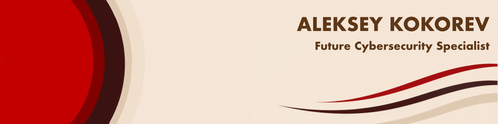
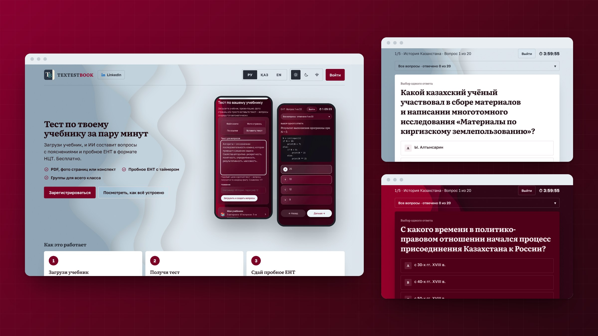
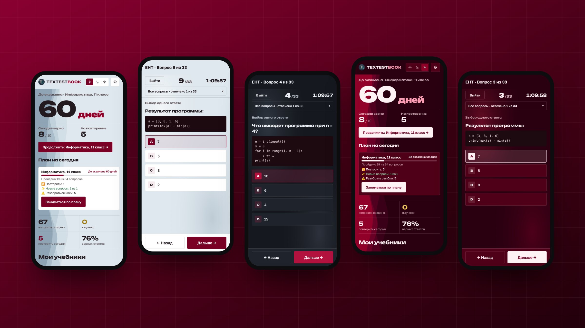
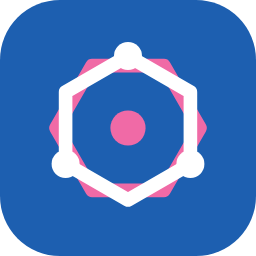
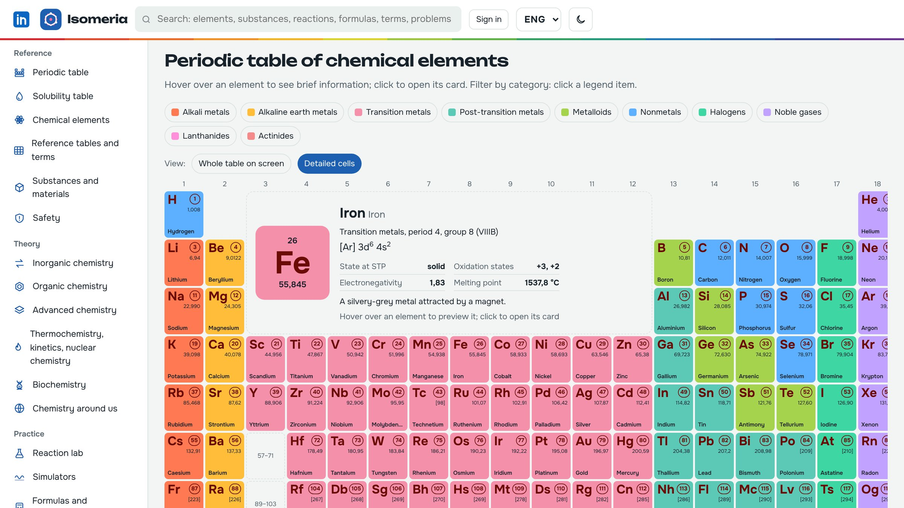
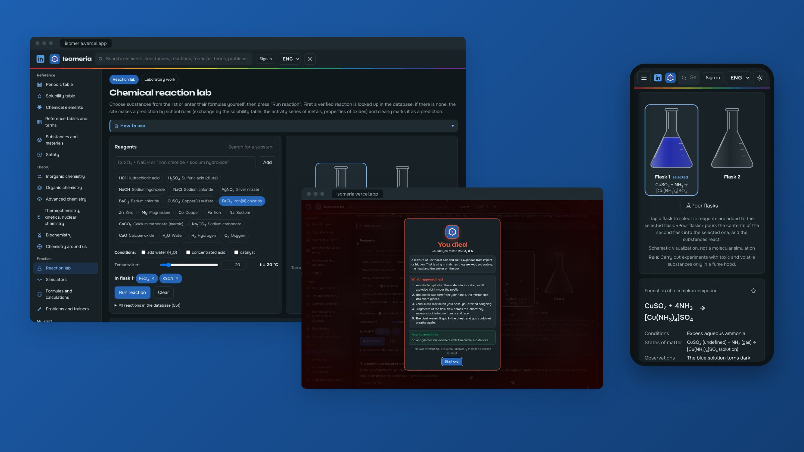

  
  
  
  

I'm a developer from Kazakhstan. I like shipping things people actually use: a full product, from the database to the Android app.

*Привет! Делаю TEXTESTBOOK — сервис, который превращает учебники в тесты и пробный ЕНТ.*

---

## 📚 TEXTESTBOOK

**Upload a textbook — get tests.** AI reads a PDF, writes questions with explanations and page references, then builds a study plan with spaced repetition and a full practice **UNT (ЕНТ)**: 120 tasks, 240 minutes, real scoring.

 

<table>
  <tr>
    <td width="62%"></td>
    <td width="38%"></td>
  </tr>
  <tr>
    <td align="center"><b>Website</b> · Next.js</td>
    <td align="center"><b>Android app</b> · Expo / React Native</td>
  </tr>
</table>

**What's inside**

- 🧠 AI question generation from any PDF textbook, with explanations and source pages
- 🎯 Practice UNT mode with timer, question grid and score out of 140
- 🗓️ Exam-date study plan and spaced repetition of mistakes
- 🇰🇿 History of Kazakhstan chronology — 100 key dates turned into questions
- 🌗 Three themes (light, dark, burgundy), Russian / Kazakh / English interface
- ✅ 180+ backend tests, CI with Android E2E checks

  
  
  
  
  
  
  
  
  
  
  

👉 **Try it:** [textestbook.vercel.app](https://textestbook.vercel.app/welcome) · **Android:** [download the app](https://textestbook.vercel.app/app)

---

## 🧪 Isomeria

**Mix substances and see what happens.** An interactive chemistry platform: a periodic table with a detailed card for every element, a virtual reaction lab, simulators, reference tables and practice problems with step-by-step solutions.

 

<table>
  <tr>
    <td width="50%"></td>
    <td width="50%"></td>
  </tr>
  <tr>
    <td align="center"><b>Elements</b>, light theme</td>
    <td align="center"><b>Reaction lab</b>, dark theme</td>
  </tr>
</table>

**What's inside**

- ⚛️ All 118 elements: electron configuration, atom diagram, isotopes, properties, discovery history and sources
- 🧫 Virtual lab with 173 reagents and 551 verified reactions: colour changes, precipitates, gases, balanced equations
- 💥 27 dangerous combinations that end in a lab accident, with an explanation of how to avoid it
- 📊 8 simulators: crystal lattices, electrolysis, equilibrium, titration, gas laws, pH, reaction rate
- 🧬 Organic chemistry with 38 rotatable 3D molecules and an IUPAC naming trainer
- 🔥 Thermochemistry, kinetics and nuclear chemistry with calculators
- ✏️ 147 problems at five levels, from beginner to olympiad, plus a personal learning path
- 📚 Solubility table, activity series, glossary of 163 terms and printable reference tables
- 🌗 Light and dark themes, Russian / Kazakh / English interface, data checked against IUPAC, NIST and PubChem

  
  
  
  
  
  
  

Design, data verification and original idea: Viktoria Alpatova.

👉 **Try it:** [isomeria.vercel.app](https://isomeria.vercel.app)
